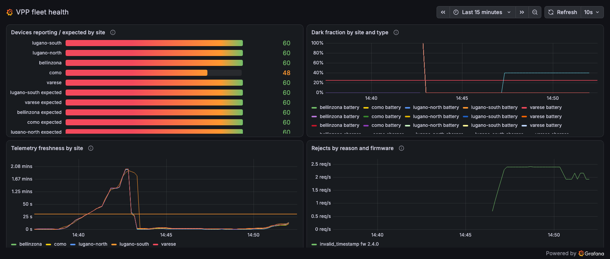

# vpp-sentinel

> *From reacting to problems to preventing them.*

I built this over a weekend to show how I think about keeping a distributed
energy platform healthy: a simulated fleet of chargers, batteries and solar
inverters streams telemetry over MQTT into a Python ingestion service on
Kubernetes, Prometheus and Loki watch it, and an incident agent investigates
every alert, acts only within an allowlist, and opens a pull request when the
cause is in the code. The architecture and every design decision are mine;
the implementation was done with AI assistance, which is itself part of what
the platform-health role asks for.

## Sixty seconds

1. **A site goes dark.** Forty percent of one site's chargers switch to a new
   firmware and the platform stops storing their telemetry. The alert fires
   195 s after the fault is injected.
2. **The agent reads before it acts.** It receives a sanitised, read-only
   context — timing, blast radius ("12 of 30 chargers at como"), severity,
   whether this was seen before, the warning logs and the runbook — then
   queries Prometheus and Loki, reads the ingestion code, writes a failing
   regression test, fixes the code, and runs the suite in a separate
   container that holds no secrets.
3. **It opens a pull request it cannot merge.** 138 s after the alert the
   fix is on GitHub, and the incident report follows on the same pull
   request at 171 s, for a human to review:
   [pull request #1](https://github.com/berkayturk/vpp-sentinel/pull/1) —
   opened by an earlier rehearsal and updated in place by the measured run,
   because the same incident fingerprint always lands on the same branch.
   The other scenario — a telemetry surge that the single consumer cannot
   absorb — ends with the one action the allowlist permits, a rollout
   restart, 73 s after the alert, and a report that says
   plainly it is a mitigation, not a fix.



*The brief 100 % spike on "dark fraction" is the reporting gauges resetting while
ingestion restarts; the alert's two-minute hold is there so it never fires on that.*

## Measured

Numbers from one protocol run on a fresh cluster (`make capture`, with the
sources of each cell stated in [docs/kpis.md](docs/kpis.md)).

| KPI | Load surge (restart) | Firmware drift (pull request) |
|---|---|---|
| Detection: fault injected → alert firing | 172 s | 195 s |
| Action: alert firing → allowlisted restart | 73 s | — |
| Pull request: alert firing → PR opened or updated | — | 138 s |
| Report filed after the alert | 124 s | 171 s |
| Resolution: alert firing → alert resolved | 150 s | — |
| Alerts fired → actions taken | 2 / 2 | |
| Model cost for both incidents | 2.80 USD (588 k input / 22 k output tokens, no caching) | |

The agent's own report for the firmware-drift incident is in
[docs/sample-report.md](docs/sample-report.md), copied verbatim from the
`incidents` table.

## What the agent may and may not do

Three tiers, enforced in code rather than in the prompt:

1. **Report** — always. Every incident ends with a structured report stored
   on the incident and emitted to Loki.
2. **Allowlisted actions** — [`allowlist.yaml`](allowlist.yaml) names the one
   deployment the agent may restart and a cooldown; the tool refuses anything
   else, and Kubernetes RBAC plus an admission policy refuse it a second time.
3. **Code fix** — the agent may read and edit `services/ingestion/` only, must
   pass the test suite before it can push, and can open or update a pull
   request. There is no merge tool.

Ten tools exist and a test asserts the registry is exactly those ten: no
shell, no kubectl, no merge. Device identifiers, addresses and tokens are
masked before the model sees anything. The tests the model writes run in a
sidecar container with another user, no secrets and no service-account token.
Each boundary has a test; [docs/architecture.md](docs/architecture.md)
lists what every tool refuses and what the remaining limitations are.

## Architecture

```
 fleet-simulator ──MQTT──▶ mosquitto ──▶ ingestion ──asyncpg──▶ postgresql
 300 devices, 5 sites                        │  parse → store → metrics → log   telemetry, incidents
 fault switches                              │                                      ▲
                                 metrics ────┤                                      │ reports, memory
                                             ▼                                      │
   Alloy ──logs──▶ Loki      Prometheus ──2 alerts──▶ Alertmanager ──polled──▶ incident agent ──▶ GitHub PR
                    └──────────────┬──────────────────────┘                        │ allowlisted restart
                                   ▼                                                ▼
                         Grafana (2 dashboards)                              ingestion (rollout)
```

- **Platform** — a Python fleet simulator with domain-correct physics and two
  fault switches; an asyncio ingestion service with bounded metric labels and
  JSON logs; PostgreSQL. [docs/architecture.md](docs/architecture.md)
- **Observability** — kube-prometheus-stack, Loki and Alloy from one Helm
  chart; exactly two alerts, unit-tested with promtool, each linked to a
  runbook in [docs/runbooks](docs/runbooks); two provisioned dashboards.
- **Agent** — the official Anthropic SDK with custom tools only; one pod,
  one allowlist, one pull-request branch per incident fingerprint.

## Run it

### Prerequisites

- Docker (Desktop or Engine)
- [kind](https://kind.sigs.k8s.io/), `kubectl`, [Helm 3](https://helm.sh/)
- [uv](https://docs.astral.sh/uv/) (Python 3.12 is installed by uv on demand)
- For the incident agent (optional — without it the platform and dashboards still run):
  - `ANTHROPIC_API_KEY` in your environment (an Anthropic API key; one incident run
    costs roughly 1–2 USD on Claude Opus; the measured two-incident protocol
    cost 2.80 USD)
  - `GITHUB_TOKEN`: a fine-grained personal access token for the repository the
    agent should open pull requests on, with *Contents: write* and
    *Pull requests: write*; set `agent.repo` in `deploy/chart/values.yaml` to your
    fork. The agent never merges; enable branch protection with Code Owner review
    on `main` so `CODEOWNERS` is enforced.

`make demo` stores both values in a Kubernetes Secret in the cluster; they are never
written to the repository.

| Command | What it does |
|---|---|
| `make demo` | Builds the images, creates the `vpp-sentinel` kind cluster if needed and deploys the observability stack and the platform |
| `make status` | Lists pods, active faults and active alerts |
| `make grafana` | Opens Grafana on `localhost:3000` (admin / `vpp-demo-password`) |
| `make alerts` | Lists active alerts |
| `make agent-logs` | Follows the incident agent's log: incidents, tool calls, reports |
| `make incident-load-surge` | One site publishes telemetry 50× faster for 180 s |
| `make incident-firmware-drift` | 40 % of one site's chargers switch to a newer firmware revision |
| `make incident-clear` | Switches every fault off |
| `make capture` | Runs both scenarios in order and writes `docs/kpis.md` and `docs/sample-report.md` (needs the agent credentials; 2.80 USD on Opus in the measured run) |
| `make down` | Deletes the kind cluster |

Developer loop: `make test`, `make lint`, `make alerts-test` (alert rules are
unit-tested with promtool) and `make dashboards-check`.

Two things are deliberate and disclosed: the `incidents` table ships with one
seeded historical incident so a first run can show the memory lookup, and the
platform ships with one deliberate code-level defect that the incident
scenarios expose. This README does not say what the defect is; the agent's
pull request does.

## What I would do next

1. A `NetworkPolicy` for the test-runner container, on a cluster whose network
   plugin enforces it; today the runner can reach the internet because `uv`
   needs PyPI.
2. An Alertmanager webhook instead of polling, so the agent wakes within
   seconds and the pager path is the real one.
3. A replay mode that re-plays a recorded agent run without an API key, so a
   reader can watch the whole story for free.
4. Prompt caching on the agent's requests — the two measured incidents sent
   about 590 k input tokens, most of them the same system prompt and context.
5. "Promotion": when the agent has proposed the same action several times and
   a human approved it each time with a good outcome, propose adding it to the
   allowlist through a pull request.

## What I don't know yet

I hold CKA and CKAD and have run clusters I built myself, not a production
fleet platform with thousands of real devices and the operational history
that comes with it. The simulator here is honest about
physics but not about the ways real firmware, networks and customers fail.
I do not yet know how this agent behaves on an alert it has never seen, or
what its cost looks like at fleet scale with hundreds of incidents a month;
the measured run above is one run. Those are exactly the things I would want
to learn with the team that operates the real platform.

— Berkay Türk
